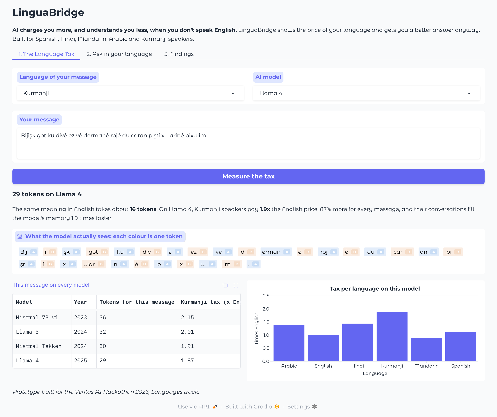

# Alan's Claude section

Everything from Alan's planning session with Claude on Saturday, November 14, 2026, for the
Veritas AI International High School Hackathon 2026.

**Our pick: LinguaBridge (AI + Languages track).** AI models charge, slow down and run out of
memory by the *token*, and the same message costs more tokens in some languages than in
English. LinguaBridge measures that "language tax" for Spanish, Hindi, Mandarin, Arabic and
Kurmanji, and gets speakers a better answer by bridging through English when that helps.



## What's in here

| Folder | What it is | Status |
| --- | --- | --- |
| `demo/linguabridge/` | The app (Gradio), the evaluation, the Colab notebook | Tab 1 and 3 tested; tab 2 and `evaluate.py` need a Colab GPU |
| `experiments/language_tax/` | The token-tax pilot results for six languages | Run |
| `experiments/scambreaker/` | Attacking the organisers' sample scam filter | Run; results in `results.txt` |
| `experiments/pumpguard/` | Check of the pump-and-dump dataset | Run; results in `results.txt` |
| `plan/` | The full plan doc (exported) and the history of every idea round | |

## The pilot finding

Tokens needed for the same 12 sentences, as a multiple of English (lower is cheaper):

| Tokenizer | Year | Spanish | Hindi | Mandarin | Arabic | Kurmanji |
| --- | --- | --- | --- | --- | --- | --- |
| Mistral 7B v1 | 2023 | 1.53x | 4.41x | 1.41x | 3.32x | 2.15x |
| Llama 3 | 2024 | 1.33x | 2.22x | 1.02x | 1.40x | 2.01x |
| Mistral Tekken | 2024 | 1.20x | 1.55x | 1.11x | 1.09x | 1.91x |
| Llama 4 | 2025 | 1.12x | 1.43x | 0.88x | 1.39x | 1.87x |

Newer models cut the tax sharply for Hindi and Arabic. Kurmanji stays the most expensive on every
model. Dropping Kurmanji's accented letters cuts its tokens by 13 to 16%, so the tokenizer charges
extra for the language's own alphabet.

**Not proven yet:** the 12 sentences were translated by Claude and each of us must check our own
language; the full study uses 1,012 FLORES+ sentences (`flores_study.py`). Whether answers get
worse, and whether bridging fixes it, is measured by `evaluate.py`, which has not been run yet.

## Run it

**Colab (recommended):** open `demo/linguabridge/LinguaBridge_Colab.ipynb`, set the runtime to
T4 GPU, and run the cells in order.

**Locally (tabs 1 and 3 only, no GPU):**

```bash
cd "Alans Claude/demo/linguabridge"
pip install -r requirements.txt
pip install --no-deps llama-models
python app.py
```

## Next steps for the team

1. Each speaker checks their language in `demo/linguabridge/data/pilot_sentences.json`.
2. Run `flores_study.py` for the full tax table (needs a Hugging Face account).
3. Run `evaluate.py --n 50` on a Colab GPU. Its results decide the route per language and give
   the "does the bridge work?" headline.
4. Rate 20 bridged and 20 direct answers each, in our own languages.

## AI credits

Claude (Anthropic) helped plan, rank ideas, draft translations of the pilot sentences and write
the code in this folder during the hackathon. The team must be able to explain every line before
submitting. Tokenizers: Meta `llama-models`, Mistral `mistral-common`, OpenAI `tiktoken`, Qwen.
Models: NLLB-200 (Meta), Qwen 2.5 (Alibaba). Datasets: FLORES+, Belebele, SMS Spam Collection,
La Morgia et al. pump-and-dump dataset.
